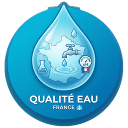
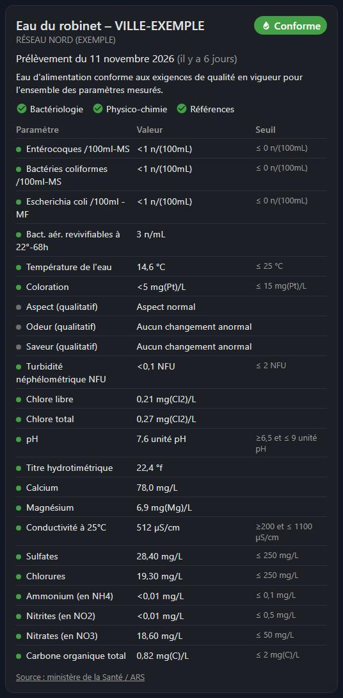
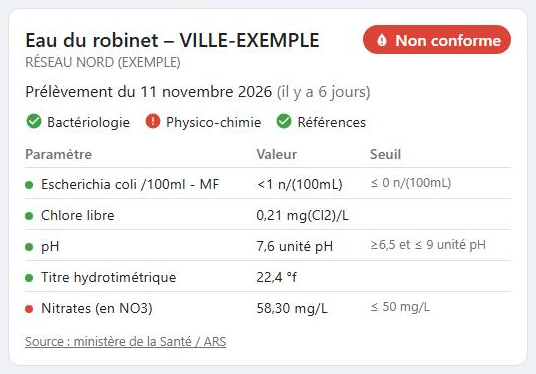

<p>
  ☕ <strong>Si cette intégration vous est utile, vous pouvez soutenir le projet :</strong>
</p>

<div style="white-space: nowrap; line-height: 0;">
  <a
    href="https://www.buymeacoffee.com/Marlboro62"
    target="_blank"
    rel="noopener noreferrer"
    style="display: inline-block; text-decoration: none; vertical-align: middle;"
  ></a>&nbsp;&nbsp;<a
    href="https://ko-fi.com/M4M2QL45X"
    target="_blank"
    rel="noopener noreferrer"
    style="display: inline-block; text-decoration: none; vertical-align: middle;"
  ></a>
</div>

#  Qualité de l'eau potable (Orobnat) pour Home Assistant

[](https://www.home-assistant.io/integrations/marketplace/)
[](https://github.com/Marlboro62/ha-qualite-eau/releases)

Suivez la qualité de l'eau du robinet de votre commune, avec les **derniers résultats du contrôle sanitaire** publiés par les ARS sur [orobnat.sante.gouv.fr](https://orobnat.sante.gouv.fr) : nitrates, chlore, pH, dureté, bactéries, conformité…

Ces données sont souvent **plus récentes** (quelques jours) que celles de l'API Hub'Eau (plusieurs mois de décalage).

- Configuration entièrement à la souris : région → département → commune → réseau
- Un capteur par paramètre analysé, avec unité et historique (graphiques)
- Une **carte Lovelace** incluse, sans installation séparée
- Plusieurs communes possibles

🎮 **[Essayer la démo en ligne](https://marlboro62.github.io/ha-qualite-eau/docs/demo.html)** : la vraie carte avec des données simulées, sans installer Home Assistant.

| Sombre, bulletin complet | Clair, nitrates au-dessus de la limite (paramètres principaux) |
| --- | --- |
|  |  |

*Aperçus avec une commune et des valeurs fictives.*

## Remerciements

Merci à **[Cede69](https://forum.hacf.fr/u/cede69)** pour l'idée de départ : son sujet sur le forum HACF, [Suivi de la qualité de l'eau en France](https://forum.hacf.fr/t/suivi-de-la-qualite-de-leau-en-france/85720), a montré que le site Orobnat publiait des résultats bien plus récents que Hub'Eau. Cette intégration en est née. 💧

## Installation

### Avec la Marketplace (Home Assistant 2026.11 et plus récent)

1. **Paramètres → Marketplace**, puis **Add from link** (en haut à droite).
2. Collez `https://github.com/Marlboro62/ha-qualite-eau` et choisissez le type **Integration**.
3. Installez « Qualité de l'eau (Orobnat) », puis **redémarrez Home Assistant**.

> Sur une version plus ancienne avec HACS : HACS → ⋮ → Dépôts personnalisés → même lien, catégorie *Intégration*.

### Manuelle

Copiez le dossier `custom_components/orobnat` dans le dossier `custom_components` de votre configuration, puis redémarrez.

## Configuration

**Paramètres → Appareils et services → Ajouter une intégration → « Qualité de l'eau (Orobnat) »**, puis choisissez :

1. votre **région** ;
2. votre **département** ;
3. votre **commune** ;
4. votre **réseau de distribution** (seulement si la commune en a plusieurs).

Les listes viennent directement du site du ministère : aucun code à chercher. Recommencez pour ajouter une autre commune.

## Entités créées

Pour une commune « Lyon », l'appareil s'appelle **Eau Lyon** et contient :

| Entité | Exemple | Description |
|---|---|---|
| `sensor.eau_lyon_bulletin` | `Conforme` | Conformité globale du dernier bulletin. Les attributs contiennent tout le détail (utilisés par la carte). |
| `sensor.eau_lyon_date_du_prelevement` | `04/11/2026 11:11` | Date du dernier prélèvement |
| `sensor.eau_lyon_nitrates_en_no3` | `3.9 mg/L` | Un capteur par paramètre analysé |
| `sensor.eau_lyon_chlore_libre` | `0.06 mg(Cl2)/L` | … |
| `sensor.eau_lyon_ph` | `7.4` | … |

Bon à savoir :

- Une valeur « inférieure au seuil de détection » (par exemple `<0,1 NFU` ou `<1 n/(100mL)`) est enregistrée comme **0**. Le texte d'origine reste dans l'attribut `valeur_brute`, et l'attribut `inferieur_au_seuil` vaut `true`.
- Tous les prélèvements ne mesurent pas tous les paramètres. Chaque capteur garde **sa dernière valeur connue**, et l'attribut `date_prelevement` indique de quand elle date.
- Les attributs `limite_qualite` et `reference_qualite` donnent les seuils réglementaires.
- Le site est interrogé **toutes les 12 heures**. Inutile d'aller plus vite : les bulletins sont publiés tous les quelques jours ou semaines.

## Carte Lovelace

La carte est chargée automatiquement par l'intégration. Dans un tableau de bord : **Ajouter une carte → « Qualité de l'eau »**, ou en YAML :

```yaml
type: custom:qualite-eau-card
entity: sensor.eau_lyon_bulletin
```

Options :

| Option | Défaut | Description |
|---|---|---|
| `entity` | — | Le capteur **Bulletin** de la commune |
| `title` | `Eau du robinet – <commune>` | Titre de la carte |
| `conclusions` | `true` | Affiche le texte des conclusions sanitaires |
| `parametres` | tous | Liste de paramètres à afficher (début du nom), par exemple `[Nitrates, Chlore libre, pH, Titre hydrotimétrique]` |

Chaque paramètre a une pastille : 🟢 dans les normes, 🟠 référence de qualité non respectée, 🔴 limite de qualité dépassée.

## Exemple d'automatisation

```yaml
automation:
  - alias: "Alerte eau non conforme"
    triggers:
      - trigger: state
        entity_id: sensor.eau_lyon_bulletin
        to: "Non conforme"
    actions:
      - action: notify.notify
        data:
          title: "💧 Eau du robinet"
          message: "{{ state_attr('sensor.eau_lyon_bulletin', 'conclusions') }}"
```

## Comment ça marche

Le site Orobnat n'a pas d'API. C'est une application web qui garde une **session** sur le serveur : il faut enchaîner les étapes du formulaire (département, commune, réseau, recherche) avec les mêmes cookies, sinon le site renvoie vers sante.gouv.fr. L'intégration reproduit ce parcours avec une simple requête HTTP, sans navigateur ni Selenium. Elle lit ensuite le tableau de résultats.

Si le site change de présentation, l'intégration peut cesser de fonctionner : ouvrez une *issue*.

## Source des données

Ministère de la Santé et de la Prévention, Agences régionales de santé : résultats du contrôle sanitaire des eaux destinées à la consommation humaine. Cette intégration n'est pas affiliée au ministère.
